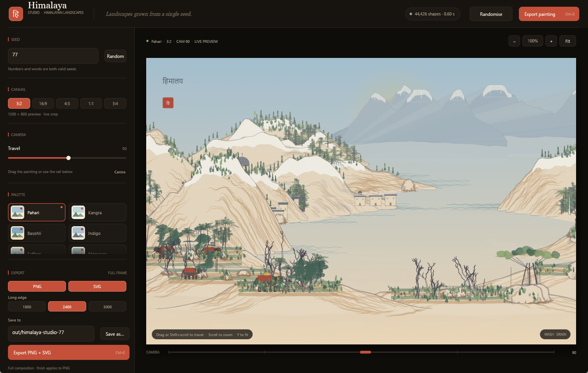
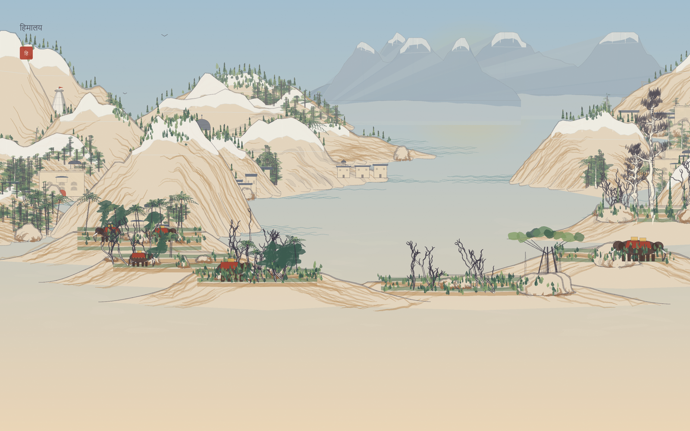
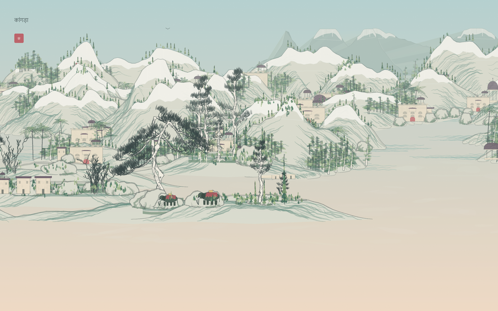
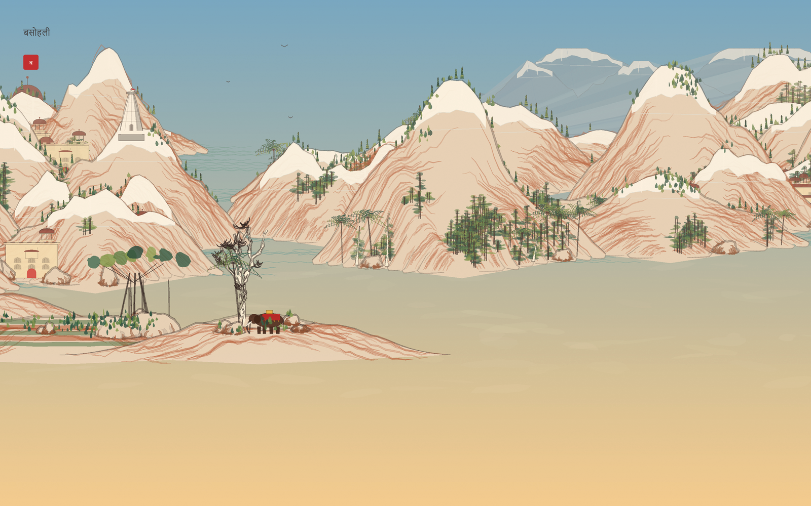
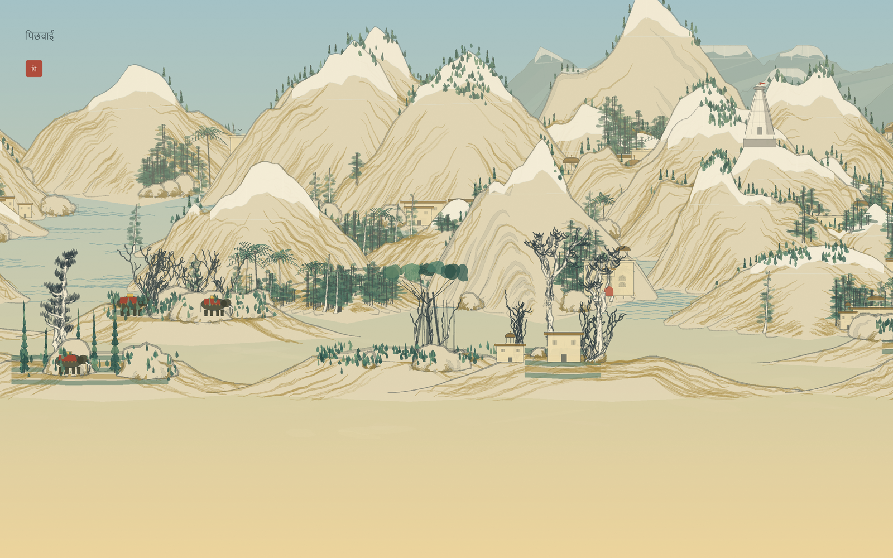
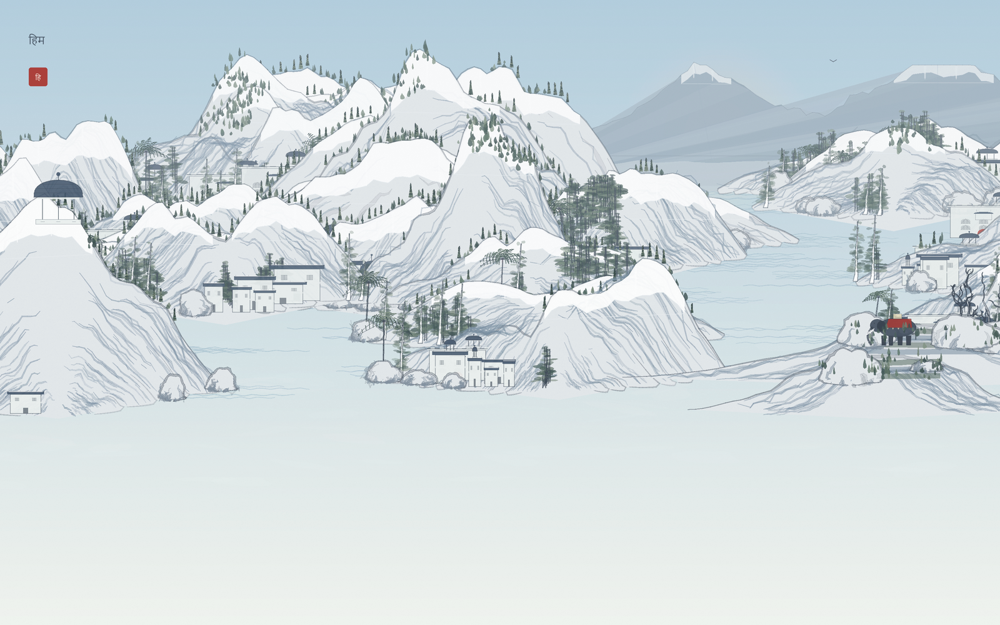

<div align="center">

# Himalaya Studio

### Himalayan miniature landscapes, grown from a single seed.

**Procedural Pahari–Kangra paintings with snow peaks, shikhara temples, ghats and elephants.**

Himalaya Studio is a standalone Rust generator and realtime desktop studio. Every painting is built from geometry — ridges, snow, trees, architecture, water, people and Devanagari inscriptions — with no bitmap assets and no machine-learning step.

[](https://github.com/incredibleamir-dot/himalaya-studio/actions/workflows/rust.yml)
[](https://github.com/incredibleamir-dot/himalaya-studio)
[](LICENSE)
[](https://www.rust-lang.org/)
[](https://github.com/incredibleamir-dot/himalaya-studio)



</div>

---

## A painting, not a filter

Every seed produces a new composition: snow-capped ridges, terraced foothills, shikhara temples, chhatris, havelis, flat-roofed hill houses, riverside ghats, cypress and banyan trees, elephants, boats, birds and a Devanagari inscription. There are no bitmap assets and no machine-learning step. The same seed and settings always produce the same painting.

The landscape engine is a Rust implementation of the original [{Shan, Shui}\*](https://github.com/LingDong-/shan-shui-inf) browser generator. Himalaya Studio keeps its deterministic machinery — seeded random streams, [p5.js](https://p5js.org/)-compatible [Perlin noise](https://en.wikipedia.org/wiki/Perlin_noise) and an endless horizontal world — and replaces the visual vocabulary with the grammar of [Pahari](https://en.wikipedia.org/wiki/Pahari_painting) and [Kangra](https://en.wikipedia.org/wiki/Kangra_painting) miniatures.

The result is not a filter over a photograph, and not a copy of a historical painting. It is a generative landscape that borrows the spatial habits of [Indian miniature painting](https://en.wikipedia.org/wiki/Indian_miniature_painting): layered ridges, high horizons, small figures, jewel-like palettes and inscriptions in [Devanagari](https://en.wikipedia.org/wiki/Devanagari).

## The Himalayan vocabulary

- **Snow and rock.** Snow caps follow the highest ridge runs, with noise-broken lower edges that read as separate fields and couloirs. Far summits pick up atmospheric blue so they sit behind the nearer hills.
- **Temple and town.** [Shikhara](https://en.wikipedia.org/wiki/Shikhara) temples, domed [chhatris](https://en.wikipedia.org/wiki/Chhatri), courtyard [havelis](https://en.wikipedia.org/wiki/Haveli), flat-roofed village houses and stepped [ghats](https://en.wikipedia.org/wiki/Ghats) recur along the ridges and the water.
- **Flora and fauna.** Pines and broadleaf trees share the slopes with [cypress](https://en.wikipedia.org/wiki/Cypress), [banyan](https://en.wikipedia.org/wiki/Banyan) and palm trees; [Indian elephants](https://en.wikipedia.org/wiki/Indian_elephant) appear on terraced fields and beside the river.
- **Twelve palettes.** Warm Pahari paper, cool Kangra celadon, Basohli vermilion, Pichwai gold, monsoon slate, snow light, dusk, indigo, saffron, nocturne, pomegranate and tea.
- **Inscriptions.** Titles and seals are set in Devanagari with a system font. A seal accepts up to ten characters on one line and widens to fit them; both inscriptions remain real, selectable text in the SVG.

## Highlights

- **Deterministic seeds** — integers or words. `pahari`, `77`, `monsoon-valley` and `780389` are all valid seeds.
- **12 colour themes** — from the warm paper and indigo ink of a Pahari miniature to Basohli vermilion, Pichwai gold and high-altitude snow.
- **5 finishing presets** — Wash, Crisp, Vivid, Vintage and Noir.
- **Realtime Studio** — draft previews while you drag, a sharp render when you stop, and a cached panorama that makes camera travel instant.
- **True vector output** — every ridge, temple finial and wave is exported as [SVG](https://developer.mozilla.org/en-US/docs/Web/SVG) geometry, not a traced bitmap.
- **High-resolution [PNG](https://www.w3.org/TR/png/)** — supersampled CPU rasterisation with a [Lanczos-3](https://en.wikipedia.org/wiki/Lanczos_resampling) downsample, paper grain and finish grading.
- **Native Save As** — the [Windows common dialog](https://learn.microsoft.com/en-us/windows/win32/api/commdlg/nf-commdlg-getsavefilenamew) with `PNG + SVG`, `PNG`, and `SVG` filters; filenames follow the seed until you choose your own.
- **Small native binaries** — no browser, scripting runtime or GUI toolkit installation.
- **CLI and library** — the generator is a reusable Rust crate, independent of the GUI.

Built with [Rust](https://www.rust-lang.org/), [eframe/egui](https://github.com/emilk/egui), [ab_glyph](https://docs.rs/ab_glyph) and the [png](https://docs.rs/png) crate.

## Gallery

| | |
|:--:|:--:|
| [](Screenshots/art-pahari.png)<br><sub>**Pahari · Wash** · seed `77` · camera `90` · हिमालय</sub> | [](Screenshots/art-kangra.png)<br><sub>**Kangra · Wash** · seed `5` · कांगड़ा</sub> |
| [](Screenshots/art-basohli.png)<br><sub>**Basohli · Crisp** · seed `101` · बसोहली</sub> | [](Screenshots/art-pichwai.png)<br><sub>**Pichwai · Wash** · seed `55` · पिछवाई</sub> |
| [](Screenshots/art-snow.png)<br><sub>**Snow · Crisp** · seed `12` · हिम</sub> | <sub>Every painting above was generated by the release Rust CLI. One example command:</sub> |

```bash
himalaya-studio --theme snow --seed 12 --width 1600 --height 1000 \
  --finish crisp --title "हिम" --seal "हि" --format png \
  --out Screenshots/art-snow
```

## Quick start

### Build

```bash
git clone https://github.com/incredibleamir-dot/himalaya-studio.git
cd himalaya-studio
cargo build --release
```

The crate is self-contained: the generator, renderer, CLI and Studio all live in this repository. The release build produces two binaries:

| Binary | Purpose |
| --- | --- |
| `target/release/himalaya-studio-gui` | Himalaya Studio (Windows: `himalaya-studio-gui.exe`) |
| `target/release/himalaya-studio` | Command-line renderer |

The GUI is enabled by default. For a terminal-only build:

```bash
cargo build --release --no-default-features --bin himalaya-studio
```

### Run the Studio

```bash
cargo run --release --bin himalaya-studio-gui
```

On Windows the release GUI is linked as a windowed application, so no console window appears behind it. Build with `--features gui-console` if you want stderr and panic messages in a terminal.

> **Platforms:** the generator, CLI and both exporters build on Windows, macOS and Linux. The Studio is developed and tested on Windows 11; its native Save As dialog is Windows-only, so on macOS and Linux type the export path directly into the **Save to** field. Raster inscriptions use a Devanagari system font — Nirmala UI or Mangal on Windows, Devanagari Sangam MN on macOS, and Noto Serif Devanagari on Linux. If none is installed, add [Noto Serif Devanagari](https://fonts.google.com/noto/specimen/Noto+Serif+Devanagari) or use the SVG export.

## Using the Studio

The window is split into a control sidebar and a large painting canvas.

- **Seed** — type a number or a phrase, then press Enter or use **Random**. **Ctrl+R** also randomises the seed.
- **Canvas** — choose 3:2, 16:9, 4:3, 1:1 or 3:4.
- **Camera** — drag the painting, drag the rail at the bottom, or hold **Shift** and scroll. Scroll to zoom from 100% to 400%; double-click or press **F** to fit.
- **Inscription** — optional Devanagari title and a seal of up to ten characters. The seal stays on one line and widens to fit, and both are exported as live text in SVG.
- **Palette** — 12 themes with live swatches.
- **Density** — architecture, people, boats and dust from 0% to 100%; toggles for sky, sun, mist, vegetation and paper grain.
- **Finish** — choose a grading preset; it is applied to the PNG export and the live preview.
- **Export** — choose PNG and/or SVG, a long edge of 1600, 2400 or 3000 px, and a base path. **Ctrl+E** exports.

The Studio opens on a Pahari composition (seed `77`, camera `90`) with the inscription **हिमालय** and seal **हि**.

### Saving files

The **Save as…** button opens the [native Windows dialog](https://learn.microsoft.com/en-us/windows/win32/api/commdlg/nf-commdlg-getsavefilenamew) and chooses a *base path*. It does not write the files by itself. The export pipeline writes `<base>.png` and/or `<base>.svg` when you press **Export**. This means you can choose a destination once, adjust the painting, and export again without reopening the dialog.

By default the base path follows the seed: `out/himalaya-studio-42` for seed `42`. Typing in the **Save to** field, or choosing a path in the dialog, stops the automatic tracking. **Use seed name** restores it.

## Command line

The examples below assume `himalaya-studio` is on your `PATH` (for example after `cargo install --path .`). From a fresh build, use `target/release/himalaya-studio`.

```bash
# List the built-in palettes
himalaya-studio --list-themes

# A Pahari lake with a Devanagari inscription, both formats
himalaya-studio --theme pahari --seed 77 --camera 90 \
  --title "हिमालय" --seal "हि" \
  --width 1600 --height 1000 --out out/pahari-lake

# A large snow study with a crisp finish
himalaya-studio --theme snow --seed 12 --format png --finish crisp \
  --title "हिम" --seal "हि" \
  --width 3000 --height 1875 --out out/high-passes

# A quiet ghat with fewer people and no boats
himalaya-studio --theme pichwai --seed 55 --format png \
  --architecture 0.6 --people 0 --boats 0 \
  --title "पिछवाई" --seal "पि" --out out/ghat-evening
```

Run `himalaya-studio --help` for all options. Important flags:

| Flag | Description |
| --- | --- |
| `--seed <SEED>` | Integer or text seed. Omit for a time-based seed. |
| `--theme <THEME>` | One of the 12 palettes. Default `pahari`. |
| `--camera <X>` | Horizontal centre of the view. Default `0`. |
| `--width`, `--height` | Output size in pixels. Default `1200 × 800`. |
| `--format <png\|svg\|both>` | Output format. Default `both`. |
| `--out <PATH>` | File or base path. `.png`/`.svg` are added automatically. |
| `--supersample <N>` | PNG supersampling factor. Default `2`. |
| `--finish <PRESET>` | `wash`, `crisp`, `vivid`, `vintage` or `noir`. |
| `--title`, `--seal` | Inscription and red seal in Devanagari. |
| `--title-size <PX>` | Inscription size. Default `22`. |
| `--paper`, `--no-paper` | Paint the paper background. Default on. |
| `--grain`, `--no-grain` | Paper grain. Default on. |
| `--sky`, `--sun`, `--mist` | Toggle sky gradient, sun and mist. |
| `--vegetation` | Toggle trees and greenery. |
| `--architecture`, `--people`, `--boats`, `--dust` | Densities from `0` to `1`. |
| `--birds <N>` | Number of birds. Default `5`. |
| `--chunk-width <PX>` | Generation chunk width. Default `512`. |

The CLI writes deterministic files. If you re-run the same command, the PNG and SVG are byte-for-byte reproducible on the same platform and font set.

## Themes and finishes

### Themes

| Theme | Character |
| --- | --- |
| `pahari` | Warm kangra paper, indigo ink, ochre rock and vermilion accents |
| `kangra` | Cool celadon, rose and a soft apricot horizon |
| `basohli` | Vermilion grounds, lapis sky and saturated emerald foliage |
| `indigo` | A monochrome study in lapis and ivory |
| `saffron` | Marigold and turmeric over a warm cream ground |
| `monsoon` | Wet slate, grey-green hills and a bleached horizon |
| `snow` | The high Himalaya under a pale winter sky |
| `dusk` | Rose sky, violet shadow and ember light over the foothills |
| `pichwai` | The gold-leaf shrine palette of [Nathdwara](https://en.wikipedia.org/wiki/Nathdwara) |
| `nocturne` | Indigo night, silver ink and a single warm lamp |
| `pomegranate` | Anar red, rose paper and green shadow |
| `tea` | The terraced [Darjeeling](https://en.wikipedia.org/wiki/Darjeeling) gardens in spring |

### Finishes

| Finish | Effect |
| --- | --- |
| `wash` | Neutral, soft paper-and-pigment look |
| `crisp` | A little more contrast and saturation |
| `vivid` | Stronger colour separation |
| `vintage` | Warm, faded cross-process grade |
| `noir` | Black-and-white with lifted contrast |

Finish grading is applied to the raster PNG. The SVG remains pure vector geometry and keeps the theme's original colours.

## Changes from the original

The original **{Shan, Shui}\*** is a browser piece: [HTML](https://developer.mozilla.org/en-US/docs/Web/HTML), [JavaScript](https://developer.mozilla.org/en-US/docs/Web/JavaScript), [p5.js](https://p5js.org/) noise and an endlessly scrolling SVG. Himalaya Studio is a standalone Rust application built on the same deterministic engine model, with a new Himalayan visual language and a native desktop workflow:

- **A new art direction.** Snow-capped ridges, terraced fields, shikhara temples, chhatris, havelis, ghats, cypress and banyan trees, elephants and Devanagari inscriptions replace the original object set, colour language and composition rules.
- **A native single-binary Studio.** No browser tab, runtime or GUI toolkit to install. On Windows, the release GUI opens without a console window.
- **Instant camera travel.** Instead of re-rendering the whole scene on every camera move, the Studio renders a cached wide strip once and scrolls a UV window through it. Camera-only changes skip the draft pass entirely; the sharp pass catches up when the view settles.
- **A deeper art direction panel.** 12 palettes and 5 finish presets, with grain, paper, sky, sun, mist, vegetation, architecture, people, boats and dust controls.
- **A native save workflow.** The [Windows common Save dialog](https://learn.microsoft.com/en-us/windows/win32/api/commdlg/nf-commdlg-getsavefilenamew) offers combined, PNG-only and SVG-only filters, and export paths follow the seed until you edit them.
- **An asynchronous render pipeline.** Draft and final previews run on a worker with cancellation; exports run on a separate worker with progress stages, so the UI stays responsive.
- **Print-sized exports.** 1600, 2400 or 3000 px on the long edge, PNG and SVG from the same composition, with seed-stable grain.
- **A reusable crate.** The generator, palettes, rasteriser and SVG writer are exposed as a Rust library; the CLI and GUI are thin front ends.
- **A reproducible CLI.** RNG child streams, item ordering and SVG serialisation are stable, and `examples/dump_scene.rs` emits a scene dump for regression checks.

## How it works

The short version:

1. A seed is hashed into a [Blum-Blum-Shub](https://en.wikipedia.org/wiki/Blum_Blum_Shub) generator. Every component gets a labelled child stream, so adding a tree does not reshuffle the mountains.
2. A [p5.js](https://p5js.org/)-compatible [Perlin noise](https://en.wikipedia.org/wiki/Perlin_noise) field decides where mountain massifs, distant ranges, flats and boats belong along an endless horizontal strip.
3. Items are generated in 512 px chunks and cached. Each item expands into low-level polygons, circles, gradients and text.
4. The renderer sorts by depth and y, paints the sky, sun, birds, mountains, water, mist, buildings, trees and inscription, then supersamples and downsamples the PNG or serialises the same shapes to SVG.
5. The Studio keeps a 0.9-scale panorama of the whole travel range and crops it with a UV window; exports re-render the full composition sharply at the chosen size.

The full pipeline, including the RNG, noise, chunking, geometry and panorama maths, is documented in **[algo.md](algo.md)**.

## Using the crate

```rust
use himalaya_studio::render::{render_shapes, save_png, RenderOptions};
use himalaya_studio::rng::Seed;
use himalaya_studio::scene::{Scene, SceneOptions};

fn main() -> Result<(), String> {
    let mut scene = Scene::new(SceneOptions {
        seed: Some(Seed::Int(77)),
        theme: "pahari".into(),
        title: "हिमालय".into(),
        seal: "हि".into(),
        ..Default::default()
    })?;

    let shapes = scene.render(None, None, None, None);
    let bitmap = render_shapes(&shapes, &RenderOptions::default());
    save_png(std::path::Path::new("out/seed-77.png"), &bitmap)
}
```

The `examples/` directory contains runnable programs for scene dumps, camera benchmarks, primitive probes and tree regression checks:

```bash
cargo run --release --example dump_scene -- --seed 77 --width 480 --height 320
cargo run --release --example bench_camera
```

## Project layout

```
.
├── src/
│   ├── main.rs           CLI entry point
│   ├── gui_main.rs       Himalaya Studio
│   ├── lib.rs            public crate surface
│   ├── scene.rs          world, chunks and composition
│   ├── planner.rs        noise-driven item placement
│   ├── mountains.rs      massifs, terraces, snowcaps, distant ranges, rocks
│   ├── trees.rs          pines, cypress, banyan, palms, bark and branches
│   ├── architecture.rs   shikharas, chhatris, havelis, ghats, elephants, boats
│   ├── water.rs          rivers, lakes, seas, mist and birds
│   ├── people.rs         figures and turbans
│   ├── color.rs          12 palettes and depth haze
│   ├── finish.rs         post-processing presets
│   ├── context.rs        shared RNG, noise, palette and density state
│   ├── primitives.rs     geometry and random helpers for generators
│   ├── shapes.rs         shape primitives emitted by the world
│   ├── rng.rs            seed hash and Blum-Blum-Shub streams
│   ├── noise.rs          p5.js-compatible Perlin noise
│   ├── geometry.rs       curves, triangulation and polygon helpers
│   └── render/
│       ├── mod.rs        render entry points and options
│       ├── raster.rs     supersampled CPU rasteriser, grain, finishes
│       ├── svg.rs        vector serialiser
│       └── text.rs       Devanagari fonts, inscriptions and seals
├── examples/             scene dumps, benchmarks and regression probes
├── Screenshots/          Studio and generated-art images
├── algo.md               algorithm and rendering notes
├── README.md
├── LICENSE
├── Cargo.toml
└── Cargo.lock
```

## Determinism and reproducibility

The generator never reads a clock, a random device or a global mutable state during composition. All randomness comes from labelled child streams of the seed. That is why the same seed and options reproduce the same painting across runs, and why changing the title or the camera does not change the landscape.

The RNG, noise construction, child-stream labels, item ordering and shape ordering follow the original browser generator's design. The renderers reproduce the composition rather than resampling it. The SVG writer is intentionally strict about numeric formatting (two decimals with trailing zeros removed), so generated files diff cleanly between runs.

Gallery images in this README were produced by the release Rust CLI, not by a separate illustration pipeline.

## References

- [{Shan, Shui}\* — original browser generator](https://github.com/LingDong-/shan-shui-inf)
- [Pahari painting](https://en.wikipedia.org/wiki/Pahari_painting)
- [Kangra painting](https://en.wikipedia.org/wiki/Kangra_painting)
- [Basohli painting](https://en.wikipedia.org/wiki/Basohli_painting)
- [Pichwai painting](https://en.wikipedia.org/wiki/Pichwai)
- [Indian miniature painting](https://en.wikipedia.org/wiki/Indian_miniature_painting)
- [Shikhara](https://en.wikipedia.org/wiki/Shikhara)
- [Chhatri](https://en.wikipedia.org/wiki/Chhatri)
- [Haveli](https://en.wikipedia.org/wiki/Haveli)
- [Ghats](https://en.wikipedia.org/wiki/Ghats)
- [Banyan](https://en.wikipedia.org/wiki/Banyan)
- [Cypress](https://en.wikipedia.org/wiki/Cypress)
- [Indian elephant](https://en.wikipedia.org/wiki/Indian_elephant)
- [Devanagari](https://en.wikipedia.org/wiki/Devanagari)
- [Nirmala UI](https://learn.microsoft.com/en-us/typography/font-list/nirmala-ui)
- [Noto Serif Devanagari](https://fonts.google.com/noto/specimen/Noto+Serif+Devanagari)
- [Mangal](https://learn.microsoft.com/en-us/typography/font-list/mangal)
- [p5.js `noise()` reference](https://p5js.org/reference/p5/noise/)
- [Perlin noise](https://en.wikipedia.org/wiki/Perlin_noise)
- [Blum-Blum-Shub](https://en.wikipedia.org/wiki/Blum_Blum_Shub)
- [Lanczos resampling](https://en.wikipedia.org/wiki/Lanczos_resampling)
- [HTML](https://developer.mozilla.org/en-US/docs/Web/HTML)
- [JavaScript](https://developer.mozilla.org/en-US/docs/Web/JavaScript)
- [SVG](https://developer.mozilla.org/en-US/docs/Web/SVG)
- [PNG specification](https://www.w3.org/TR/png/)
- [eframe / egui](https://github.com/emilk/egui)
- [ab_glyph](https://docs.rs/ab_glyph)
- [png crate](https://docs.rs/png)
- [Windows `GetSaveFileNameW`](https://learn.microsoft.com/en-us/windows/win32/api/commdlg/nf-commdlg-getsavefilenamew)
- [MIT License](https://opensource.org/license/mit)

## Credits

- **{Shan, Shui}\*** — original concept, generator and browser implementation by [LingDong-](https://github.com/LingDong-). [Original repository](https://github.com/LingDong-/shan-shui-inf).
- **Shan Shui Rust edition** — the Rust landscape engine and Studio foundation on which this standalone application is built. [shan-shui-rust](https://github.com/incredibleamir-dot/shan-shui-rust).
- **Himalaya Studio** — Himalayan visual direction, palettes, architecture, flora and fauna, Devanagari inscriptions, documentation and artwork. [himalaya-studio](https://github.com/incredibleamir-dot/himalaya-studio).

The underlying algorithm and the original visual language belong to the original project. Himalaya Studio is an independent reinterpretation and is not affiliated with the original author.

## License

MIT. See [LICENSE](LICENSE).

The original {Shan, Shui}\* is also MIT licensed. All upstream copyright notices are retained in the license file.
